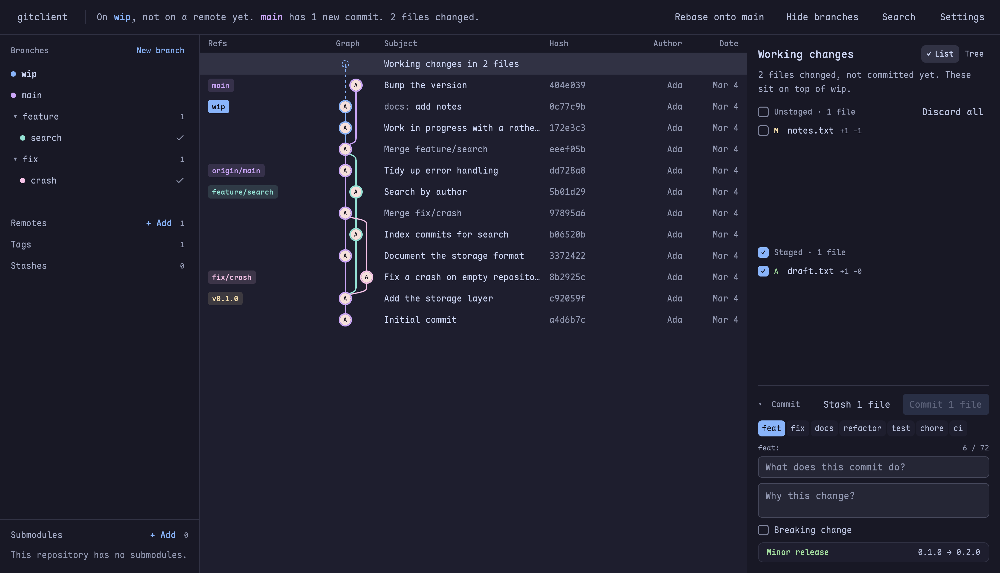

# gitclient

A desktop Git client that stays fast on big repositories.

It's written in Rust on [gpui-kit](https://crates.io/crates/gpui-kit) and talks to your
installed `git`. Git never runs on the thread that draws the window, long lists draw only
what's in view, and history loads in pages, so a commit touching 10,000 files opens as
quickly as one touching three.



## What it does

Browse history as a lane graph, stage individual hunks, commit, stash, branch, merge,
rebase, cherry-pick and revert. A few things work differently:

- **Drag a branch onto another** to get a menu of what fits how the two histories relate
  (fast-forward, merge, rebase). Dropping never does anything by itself.
- **Branch names instead of "ours" and "theirs".** Those swap meaning during a rebase, so
  the conflict resolver shows both versions of the whole file side by side, each labelled
  with its branch, next to an editable result.
- **Buttons say what they'll do** ("Push 2 commits", not "Push"), and anything risky tells
  you the command that undoes it.
- **Conventional Commits built in.** If you tag releases like `v1.2.3`, the commit form
  shows what landing the commit would do to the version.
- **Pull and merge requests** for GitHub, GitLab and Gitea remotes are listed using git
  alone, with no sign-in and no API token.

If a repository is slow to load, Settings → Repository checks whether git's commit-graph
file covers your history and writes it if it doesn't.

## Installing

Download the archive for your system from the
[releases](https://github.com/pretext8335/gitclient/releases) page (`.tar.gz` for Linux,
`.zip` for Windows), unpack it anywhere and run `gitclient`. You need `git` on your `PATH`;
a recent version is recommended, since some features, such as the sidebar's branch counts,
need it.

On first run it offers to add itself to the application menu. It checks for a newer
release on start and asks before installing one.

## Building from source

You need a recent stable Rust toolchain. On Linux you also need the usual GUI libraries:

```sh
sudo apt-get install pkg-config libxcb1-dev libxkbcommon-dev \
  libxkbcommon-x11-dev libfontconfig1-dev libfreetype-dev libwayland-dev
```

Then:

```sh
cargo run --release
cargo test                # both crates
cargo test --test render  # renders through the real GPU pipeline, opt-in
cargo fmt --all           # plain `cargo fmt` skips crates/core, and CI checks it
```

## How it's put together

Everything about a repository lives in `crates/core` (`gitclient-core`), which never
depends on the UI toolkit. The window in `src/` asks core what's true and draws the
answer, so rules and wording can be tested without opening a window. All git goes through
`crates/core/src/ops.rs`. The look and behaviour are specified in
[docs/design.md](docs/design.md).

## AI disclosure

Most of this project's code, tests, design document and commit messages were written with
[Claude Code](https://claude.com/claude-code). I decide what the application does and how
it should behave, direct the work, and use the application daily, but I have not reviewed
every line.

Quality is checked by a test suite built on throwaway repositories, and by CI, which runs
formatting, clippy with warnings as errors, and the tests.

Bug reports and pull requests are welcome. Please say if a pull request was generated.

## Contributing

Work on short-lived branches and open PRs into `main`. [CLAUDE.md](CLAUDE.md) has the
layout rules and the commands. PRs are squash-merged, so give yours a
[Conventional Commit](https://www.conventionalcommits.org) title such as `fix: ...` or
`feat: ...`.

`THIRD-PARTY-LICENSES.txt` is generated from `Cargo.lock`. After a change to dependencies
lands on `main`, CI opens a pull request that updates it, so there is nothing to run by
hand.

## License

GNU General Public License, version 3 or (at your option) any later version. See
[LICENSE](LICENSE). The licenses of everything compiled in are under Settings → About and
in [THIRD-PARTY-LICENSES.txt](THIRD-PARTY-LICENSES.txt).

The interface uses [Catppuccin](https://catppuccin.com) colours and
[Maple Mono](https://github.com/subframe7536/maple-font), which is bundled under the SIL
Open Font License; see `src/fonts/OFL.txt`.
